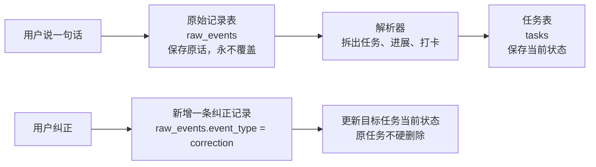
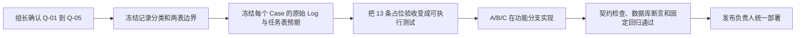

# 组长确认清单：MVP 范围与数据状态

> **2026-11-26 范围更新（待团队接口评审）：** 产品负责人已确认**12 月 10 日前完成可用版本，12 月 20 日路演**，成品必须包含真实数据的日记、周回顾、经验本。下文 Q-04 的旧 A/B/C 选项及“F8/F9 后置”建议不能用于免除日记和周回顾；Q-03／Q-05 的两表与“感受只在原始 Log 展示”是 11 月 17 日薄切片口径，需要 C 对逐段日记、排除回顾和经验收录提出迁移方案。请先读 [SPEC v1.1 修订稿](MVP_SPEC_v1.1_2026-12-10.md)，其余未决项继续按本清单评审。

这份文档只请组长确认会改变产品行为、数据含义或验收结果的事项。工程实现细节由团队决定。

先说明结论：系统当前只有两张业务表。一张保存用户原话，一张保存当前任务状态。没有必要的前提下，不增加第三张“感想表”或“画像表”。

每个验收 Case 的预期数据库前后状态，见 [验收用例与数据状态基线](acceptance-cases.md#3-每个-case-的数据状态目标)。

## 1. 三分钟看懂数据怎么存



### 1.1 两张表分别是什么

| 用户看到的概念 | 系统内部名称 | 人话解释 | 关键规则 |
|---|---|---|---|
| 原始 Log | `raw_events` | 用户每次发言都单独存一条，包括原话、来源、收到时间、解析状态和首次回执 | 原话内容不能改写；重复消息不能重复落库；纠正是新增记录 |
| 任务数据库 | `tasks` | 保存当前还要展示和操作的事项、进展和打卡 | 每条任务必须能追溯到生成它的原始 Log；撤销不硬删除 |

### 1.2 一条原始 Log 可以生成多条任务

固定主用例：

> 今天背完单词了，论文开头也改了，跟朋友聊完没那么焦虑了。

预期落库如下：

| 原话片段 | 原始 Log | 任务数据库 | 页面上的意思 |
|---|---|---|---|
| 今天背完单词了 | 同一条原始 Log | 新增 1 条 `daily_task`，状态 `done` | 今天“背单词”已完成 |
| 论文开头也改了 | 同一条原始 Log | 新增 1 条 `task_progress`，状态 `active` | “毕业论文”只记录了局部进展，整项仍未完成 |
| 跟朋友聊完没那么焦虑了 | 同一条原始 Log | **不新增任务行** | 感受按原话保留，不自动生成情绪标签或任务 |

因此固定主用例的数据库结果是：

- 原始 Log：`1` 条；
- 任务表：`2` 条；
- 两条任务都指向同一条原始 Log；
- 不出现 `reflection` 记录类型。

### 1.3 常用字段的人话解释

| 字段或状态 | 人话解释 |
|---|---|
| `event_id` | 一条原始 Log 的编号 |
| `record_id` | 一条任务记录的编号 |
| `source_event_id` | 这条任务是从哪条原始 Log 生成的 |
| `related_event_id` | 纠正记录关联到哪条原始 Log |
| `target_record_id` | 纠正记录要修改哪条任务 |
| `parse_status=received` | 原话已收到，尚未解析完成 |
| `parse_status=parsed` | 原话已解析，结果和回执已保存 |
| `parse_status=failed` | 原话已保存，但解析失败；任务表不写入半成品 |
| task `status=active` | 任务进行中 |
| task `status=done` | 任务已完成或当天打卡完成 |
| task `status=revoked` | 任务已撤销，但历史记录保留 |

## 2. 必须先拍板的 5 项

Q-01、Q-03、Q-05 是同一组数据语义的三个侧面。若你同意 1.2 的固定示例，可以统一回复“Q-01、Q-03、Q-05 均确认”。

| 编号 | 需要确认的问题 | 请选择或补充 | 对数据结构的影响 |
|---|---|---|---|
| Q-01 | 是否确认一句话可以同时生成“打卡、任务进展、生活感受”三类含义。打卡写成 `daily_task`，任务局部进展写成 `task_progress`，生活感受只留在原话里。 | 确认 / 改为： | 决定一条原始 Log 生成 0、1 还是多条任务，以及固定主用例应为 2 条任务还是更多 |
| Q-02 | 是否确认“习惯打卡”在数据里复用 `daily_task`。页面可以显示“习惯”，但数据库中不另建习惯表。 | 确认 / 改为： | 决定连续打卡、周回顾和提醒是否需要新的数据结构 |
| Q-03 | 是否确认“日记/生活感受”的来源就是原始 Log。只有用户主动要求回顾时才展示，不默认把每条原话都当成日记。 | 确认 / 改为： | 决定回顾页面读取 `raw_events`，还是新增独立日记表 |
| Q-04 | 试用前必须完成哪些范围：F6 晚间收尾、F7 提醒、F8 周回顾、F9 画像条目。 | A. F6/F7 做最小版，F8/F9 后置（建议）<br>B. 四项都在试用前完成<br>C. 四项都后置 | 决定任务表是否现在就扩展提醒和画像字段，以及要准备多少验收 Case |
| Q-05 | 是否确认生活感受不生成单独的 `reflection` 任务行，也不自动生成情绪标签。 | 确认 / 改为： | 会直接改变固定主用例的任务数、周回顾数据来源和情绪标签边界 |

其中：

- **F6 晚间收尾**：睡前回看今天、回应此刻、安排明天；
- **F7 提醒**：一次性或每日提醒，以及发送失败/过期处理；
- **F8 周回顾**：把原话与完成任务放在同一份回顾中；
- **F9 画像条目**：根据记录给出用户确认后才保存的近期状态观察。

## 3. 没有异议就采用默认口径

下表每题都补了“会写成什么数据状态”，避免只讨论概念、不讨论落库结果。

| 编号 | 问题 | 建议默认口径 | 对应数据状态 |
|---|---|---|---|
| Q-06 | 网页用户身份如何识别 | 服务端签发短期令牌；链接默认不可转发 | 不允许匿名读取任意用户任务；令牌失效时不新增、不返回任务 |
| Q-07 | “提醒已送达”怎么定义 | 只承诺尽力发送，记录待发送、已发送、失败、已过期 | 提醒状态单独记录；不能把“接口成功”写成“用户已看到” |
| Q-08 | 一条输入最多调用几次解析模型 | 最多一次解析调用；主模型失败后使用备用模型，仍算同一次解析链路 | 一条原始 Log 最多生成一份解析结果快照，不按重试次数复制原话 |
| Q-09 | 解析模型和教练模型是否分开配置 | 允许分开配置，只要求兼容同一套接口 | 解析结果写入 `parse_result_json`；教练文本只进入回执，不直接写任务 |
| Q-10 | 模型费用谁承担、是否有上限 | 单条输入设调用上限；试用设总预算，超额后回到固定 Mock 结果 | 超预算不新增任务，也不能破坏已保存的原话和回执 |
| Q-11 | 是否保存解析结果快照 | 保存 `parse_result_json` 用于回溯和错误归因，不向普通用户展示 | 解析失败时仍能解释为什么没有生成任务 |
| Q-12 | “论文开头改了”是否自动完成整项任务 | 不自动完成，只新增 `task_progress(active)`；整项只能由用户明确修改 | 原任务状态保持进行中，新增一条局部进展任务 |
| Q-13 | 撤销、删除和“这句别记”有什么区别 | 撤销保留原话与历史；“这句别记”明确清除内容；备份按期限清理 | 撤销写 `revoked_at` 或 `status=revoked`，不硬删除；明确删除才清理原话 |
| Q-14 | “一次输入、零回复、零点击”是否仍是硬指标 | 高置信场景作为硬指标；低置信允许一次合并澄清，不逐条追问 | 高置信直接写任务；低置信保留原话，任务表可暂时为空并进入待确认 |
| Q-15 | 日期或时间没有证据时怎么处理 | 留空或进入待确认，不猜成今天 | `occurred_on` 可为空；“今天”“昨天”有明确证据时才写入 |
| Q-16 | 谁判定验收结果 | 固定回归、主用例证据和真实盲测共同判定 | 验收必须对比原始 Log 和任务表实际状态，不能只看回执文字 |

补充说明：

- **高置信**：原话明确表达动作和状态，例如“背完单词了”；
- **低置信**：原话可能是计划、条件动作或指代不清，例如“准备背单词”；
- **真实盲测**：不提前告诉参与者标准答案，由真实用户按自然表达测试；
- **Mock**：固定、可重复的本地测试结果，不调用真实模型。

## 4. 每个验收 Case 要确认什么

完整数据状态表已写入 [验收用例与数据状态基线](acceptance-cases.md#3-每个-case-的数据状态目标)。组长重点确认以下四类不变量：

1. 原话永远能在原始 Log 中找到，且不会被解析结果覆盖；
2. 每条任务都能回到生成它的原话；
3. 纠正只追加历史，不覆盖原话，也不硬删除任务；
4. 解析失败、鉴权失败或非法请求时，不能写入半成品任务。

## 5. 建议怎么回复

```text
【组长确认】
Q-01：确认 / 改为：
Q-02：确认 / 改为：
Q-03：确认 / 改为：
Q-04：A / B / C，补充：
Q-05：确认 / 改为：

其他默认项：全部同意 / 需要修改：

补充的验收 Case：
```

## 6. 确认后的动作



在组长回复前，团队只做阅读、问题记录和契约准备，不按猜测扩展业务逻辑或增加数据表。
